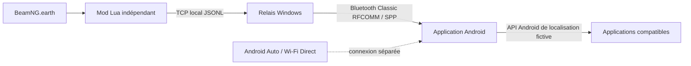

<div align="center">

# BeamNG.earth GPS Bridge

### La position de BeamNG.earth transmise à ton téléphone Android

Projet personnel de **Tiago Meira** · Windows · Kotlin · Lua · Bluetooth Classic

[](LICENSE)
[](#prérequis)
[](#prérequis)

</div>

Ce projet envoie la position géographique réelle du véhicule dans BeamNG.earth vers un téléphone Android. Le téléphone peut ensuite la publier comme position fictive Android, après activation manuelle par l’utilisateur.

## Comment ça marche



Le pont utilise les coordonnées WGS84 calculées par BeamNG.earth. Son mod Lua est séparé du mod cartographique : une mise à jour de BeamNG.earth ne remplace donc pas les fichiers du pont. Le trafic entre le jeu et le connecteur reste sur `127.0.0.1` ; le téléphone reçoit les données par Bluetooth classique.

## Fonctionnalités

- Position GPS du véhicule, vitesse et cap transmis en temps réel.
- Connecteur Windows avec liste des appareils Bluetooth appairés, reconnexion et statistiques.
- Application Android native avec réception Bluetooth, état de liaison, journal et activation explicite de l’injection.
- Messages JSON Lines versionnés, validés et limités en taille.
- Mode d’essai avec coordonnées fictives pour tester la liaison indépendamment du jeu.
- Fonctionnement local après installation : aucun compte, serveur cloud ou télémétrie.

## Télécharger l’application Android

[**Télécharger l’APK de débogage**](app-debug.apk) — version 1.0.0, compilée depuis ce projet. Sur le téléphone, ouvre le fichier téléchargé pour l’installer, puis sélectionne l’application comme **application de localisation fictive** dans les options pour les développeurs Android. Cette APK est une version de test ; Android peut demander de confirmer l’installation d’une application téléchargée.

## Installation rapide

### 1. Installer le mod BeamNG

Depuis la racine du dépôt, lance l’installation en indiquant ton dossier de données utilisateur BeamNG :

```powershell
py .\beamng-mod\install_bridge_mod.py "C:\chemin\vers\BeamNG\current"
```

Le mod apparaît dans `mods/unpacked/bng_gps_bridge`. Son relais est désactivé par défaut. Pour l’activer, mets `enabled = true` dans `lua/ge/extensions/bngGpsBridge/config.lua` du mod installé.

### 2. Démarrer le connecteur Windows

Installe Python 3.11 ou plus récent et appaire le PC avec le téléphone dans les paramètres Bluetooth. Puis lance :

```powershell
py .\windows-connector\connector.py
```

Dans la fenêtre, sélectionne le téléphone et clique sur **Connecter / réessayer**. Le connecteur n’utilise pas de paquet Python externe.

### 3. Démarrer l’application Android

Installe l’APK de débogage compilé ou reconstruis-le avec Android Studio/Gradle. Sur le téléphone :

1. Ouvre l’application et touche **Démarrer la réception Bluetooth**.
2. Dans **Options pour les développeurs → Application de localisation fictive**, sélectionne **BeamNG.earth GPS Bridge**.
3. Active l’injection dans l’application lorsque des positions valides sont reçues.

La sélection comme application de localisation fictive est une étape manuelle exigée par Android. Le pont ne contourne pas cette protection et n’a pas besoin d’ADB pour fonctionner au quotidien.

## Prérequis

| Composant | Prérequis |
|---|---|
| Jeu | BeamNG.drive et BeamNG.earth installés, avec une carte Earth chargée |
| PC | Windows 10/11, Python 3.11+, Bluetooth Classic |
| Téléphone | Android 10 ou plus récent, Bluetooth Classic et options développeur |
| Compilation Android | JDK 17, Android SDK et Gradle Wrapper fourni |

## Compilation et tests

Créer `android/local.properties` sur ta machine avec le chemin vers l’Android SDK, puis :

```powershell
cd android
.\gradlew.bat :app:assembleDebug
```

Les tests du protocole Windows :

```powershell
cd windows-connector
py -m unittest -v
py -m py_compile connector.py protocol.py bluetooth_win.py
```

## Documentation

- [Installation Windows](docs/INSTALLATION_WINDOWS.md)
- [Installation du mod BeamNG](docs/INSTALLATION_BEAMNG.md)
- [Installation Android](docs/INSTALLATION_ANDROID.md)
- [Limites et diagnostic](docs/LIMITES.md)
- [Proposition d’intégration à BeamNG.earth](docs/PROPOSITION-INTEGRATION-BEAMNG-EARTH.md)
- [Protocole partagé version 1](protocol/position-v1.schema.json)

## Limites connues

- Le pont lit actuellement `beamngEarth_core._state()`. C’est une interface interne du mod Earth ; un changement de cette API peut nécessiter une adaptation.
- Une injection Android réussie ne garantit pas que Google Maps, Waze ou une autre application acceptera la position simulée.
- Android Auto sans fil/Open Headunit et le Wi-Fi Direct ne sont pas modifiés. Leur compatibilité doit être évaluée sur les appareils réels.
- Les essais matériels Bluetooth et navigation ne sont pas remplacés par les tests logiciels.

## Projet et licence

Ce dépôt est développé et maintenu personnellement par **Tiago Meira**. C’est un projet indépendant, sans affiliation ni approbation de BeamNG GmbH ou des mainteneurs de BeamNG.earth. Le code source de BeamNG.earth n’est pas redistribué ici.

Le projet cartographique d’origine est [BeamNG.Earth par TecnaGamer](https://github.com/TecnaGamer/BeamNG.Earth). Voir aussi [la page de ses contributeurs](https://github.com/TecnaGamer/BeamNG.Earth/graphs/contributors?from=18%2F07%2F2026).

Le code original du pont est sous licence [MIT](LICENSE). Les marques BeamNG et BeamNG.earth appartiennent à leurs détenteurs respectifs.
